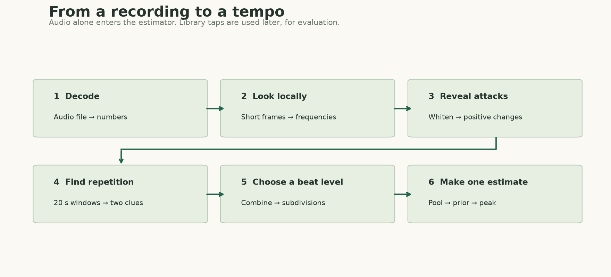
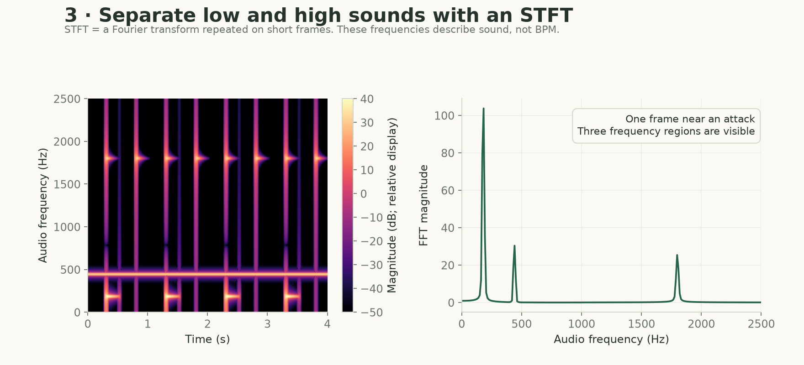
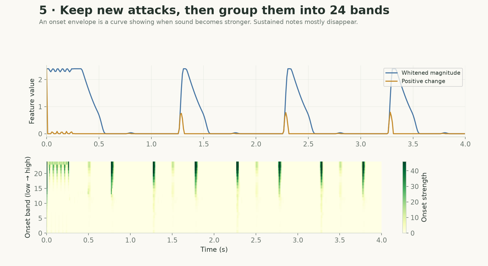
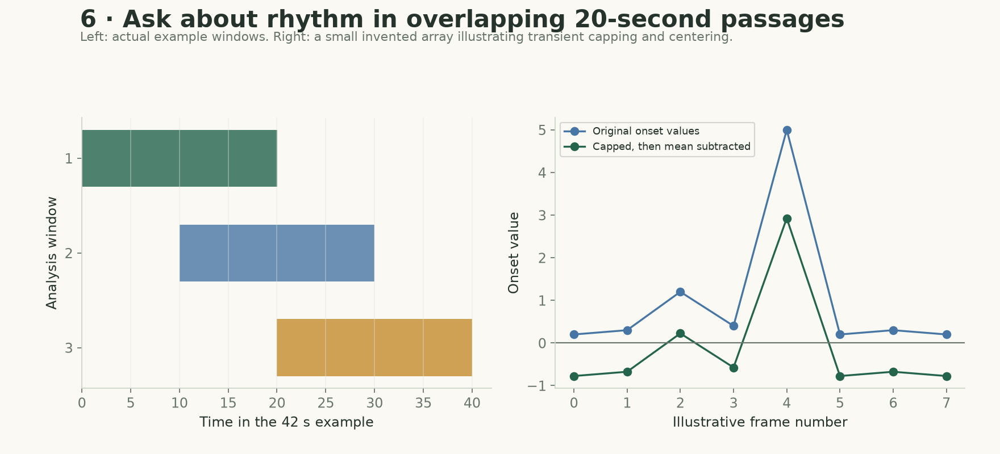
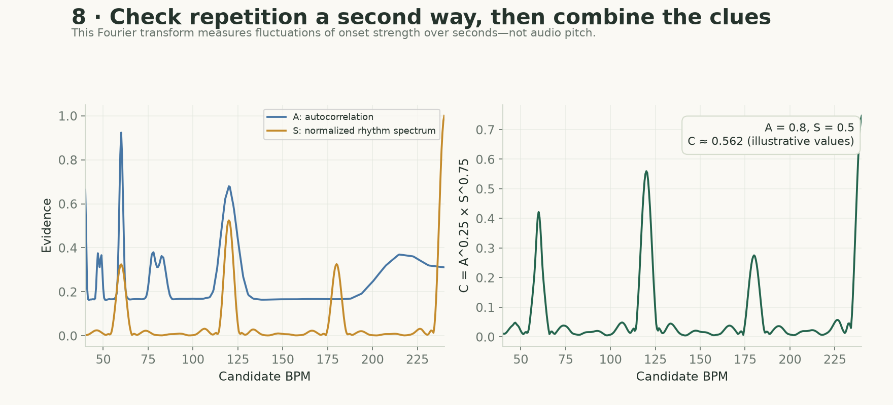
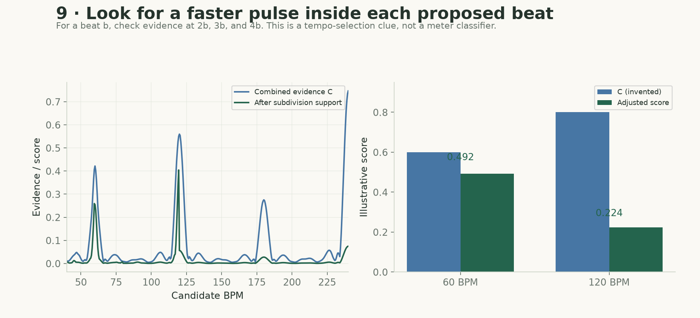
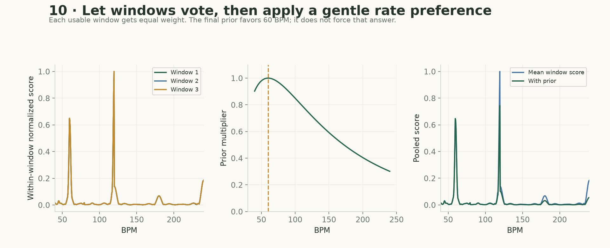
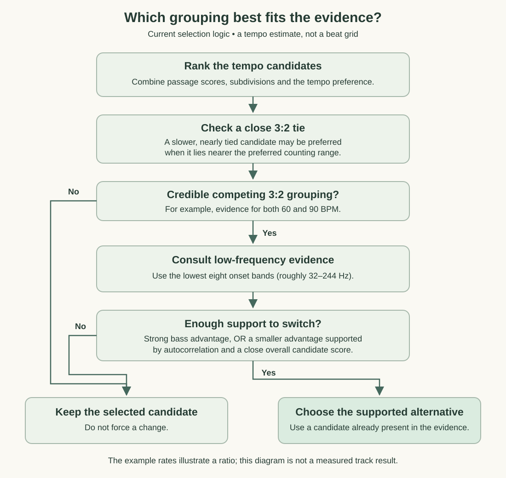

# How Tanda Forge measures BPM

Tanda Forge's optional BPM analyser was developed against music in a tango DJ's
collection, including tango, vals and milonga. Its purpose is to suggest a useful
tempo for comparing recordings and building tandas. It is not a conventional
beat tracker producing beat timestamps or a beat grid for synchronising tracks.
The design starts with the orchestral rhythms of tango rather than relying on
the regular kick-drum pattern associated with much drum-based dance music.

Use the result as a listening aid. **It is not 100% accurate.** Musicians are
human: they breathe with a phrase, lean into an accent, and slightly vary the
tempo throughout a song. A single BPM figure summarises that performance; it
cannot describe every moment. The analyser can also choose the wrong rhythmic
grouping, even when the recording's tempo is steady.

For controls and corrections, see
[Automatic BPM measurement in the user guide](user-guide.md#automatic-bpm-measurement).

## What the number tells a DJ

Two recordings near 64 BPM are worth comparing when you want a similar pace,
but their energy, phrasing, orchestration and dance feel can still differ
greatly. BPM helps narrow a search; listening decides whether the tracks belong
together.

A useful comparison also needs a consistent counting level. You might tap a
recording at 60 BPM while another listener counts the smaller pulses at 120 BPM.
Both are responding to something in the same music. An automatic estimate can
make the same choice, so an apparent factor-of-two mismatch deserves a listen
before you regard it as a completely different tempo.

## From a recording to a tempo estimate

The analyser reads audio locally using Tanda Forge's bundled FFmpeg. It uses
signal processing, with no trained AI model or cloud service. Track titles,
style tags and your entered BPM do not enter the calculation. Your entered
values and confirmed corrections affect which BPM the app uses afterwards.

The diagrams below use a deliberately simple sound: a sustained tone, bright
attacks at 120 per minute, and lower accents at 60 per minute. This makes the
steps visible. It is an illustration, not a claim that an orchestra behaves
like a metronome.

### 1. Listen for changes across the orchestra

The recording is decoded to mono at 11,025 samples per second, reading up to
the first ten minutes. Very short, overlapping slices—about 93 milliseconds
long, moving forward about 10 milliseconds at a time—separate the sound into
frequency components. This is a short-time Fourier transform, or **STFT**.

The next step reduces the dominance of loud, sustained frequencies so quieter
rhythmic changes can contribute. It then keeps increases in energy and groups
them into 24 frequency bands. These changing curves are called **onset
envelopes**: they show attacks and renewed emphasis, not confirmed beats.

For a tango orchestra, rhythmic information can be spread across bass, piano,
bandoneons and strings. Looking across frequency bands gives the analyser more
to work with than a search for a prominent drum alone. It does not identify or
separate individual instruments.

### 2. Compare passages, rather than trusting one moment

The onset curves are examined in overlapping passages of roughly 20 seconds,
starting about 10 seconds apart. An introduction, a vocal section and a strong
orchestral passage can present quite different rhythmic evidence.

Within each passage, unusually large attacks are capped and the background
level is reduced. A single dramatic accent should not decide the tempo of the
whole recording. Passages without usable rhythmic evidence are skipped. Shorter
recordings can use a shorter passage, but roughly eight seconds of usable onset
data are needed.

### 3. Ask two questions about repetition

**Does the pattern line up with a delayed copy of itself?** This is
autocorrelation. If attacks repeatedly align after half a second, that suggests
120 repetitions per minute. A one-second delay suggests 60. The relationship is
`BPM = 60 / delay in seconds`.

**How quickly does the strength of the attacks rise and fall?** A rhythm
spectrum measures that fluctuation. Here the frequencies describe the speed of
rhythmic change, rather than musical pitch.

The analyser combines these clues over candidate rates from 40 to 240 BPM.
They are complementary views of the same audio, not two independent votes.
Their combination favours candidates supported by both. The rhythm spectrum
has the greater weight; that weighting is not a probability that a BPM is
correct.

### 4. Decide which level of the rhythm to count

A fast pattern can be the beat, or a subdivision within a slower beat. Each
candidate is checked for support at twice, three times and four times its rate.
For example, a recurring 60 BPM pulse supported by activity at 120 BPM can be
more convincing than its initial score alone suggests.

Usable passages are normalised before their evidence is combined, so a loud
section does not dominate simply through volume. A gentle preference towards
rates near 60 BPM then helps choose a useful counting level. This is an explicit
design choice for this analyser, not a rule that tango should be 60 BPM. Stronger
evidence can favour a faster rate.

The current analyser also checks **3:2 grouping ambiguity**. For example, 60
and 90 BPM can compete when the same repeating pattern is grouped in twos or
threes. A close slower candidate can win a tie when it lies nearer the preferred
counting range. If a credible competing grouping remains, the lowest eight
frequency bands, roughly 32–244 Hz, provide an additional check.

A change based on bass evidence needs either a strong advantage, or a smaller
advantage supported by the broader autocorrelation evidence and a close overall
candidate score. The analyser selects an already supported candidate; it does
not simply multiply a doubtful number by 1.5. This does not classify a recording
as tango, vals or milonga, or locate the first beat of a bar.

### 5. Report a useful summary, with room for disagreement

The chosen peak is refined between the candidate grid points internally, then
Tanda Forge uses a whole-number BPM estimate. More decimal places would suggest
a precision that this measurement of a human performance cannot justify. Different
passages can favour different rates, and a shared choice across passages can
still be the wrong counting level. Insufficient evidence can produce no BPM
rather than a reliable-looking invented value.

The engine calculates local passage estimates and disagreement information;
the app presents a single effective BPM for each track. It does not provide a
tempo automation curve, place beat markers, or stretch playback to match the
number.

## Why halving and doubling still matter

Half- and double-time estimates are often called **tempo octave errors**. Here
“octave” refers to a doubling of rate, not musical pitch. A 60 BPM pulse and a
120 BPM pulse can both have strong support in one recording.

This is a recognised problem across tempo-estimation and beat-tracking
research, including modern methods. Research on expressive music describes
systems switching between plausible counting levels as tempo changes, while
recent tempo-estimation work still distinguishes performance with and without
the requirement to find the exact tempo octave. See
[Chiu and colleagues on metric-level switching](https://arxiv.org/abs/2210.06817)
and [Henkel and colleagues on tempo estimation](https://arxiv.org/abs/2401.08891).

For a DJ, the practical distinction matters: a system can identify a related
pulse correctly yet give the wrong number for the counting convention used in
your library. Evaluation that accepts half or double tempo is therefore more
forgiving than exact-rate agreement. A high score under that rule does not mean
every displayed number is suitable without review.

## When to trust your ears and override it

Small differences can reflect genuine tempo variation, the passage you tapped,
or estimation error. Larger differences can come from a competing subdivision,
syncopation, a sparse introduction or an unclear attack pattern. Human timing
is part of the explanation, but it does not account for every algorithmic error.

Listen to more than one representative passage. If the estimate is about half
or double your count, choose the counting level you use consistently across
your collection. If the music changes pace, choose a useful summary for your
DJ workflow rather than expecting a single number to describe the entire song.

In the track editor, **Tap** can supply a correction to the derived BPM while
automatic analysis is enabled. Saving asks you to confirm it. That correction
takes priority while the feature is enabled, and your original entered BPM is
retained separately. Disabling the feature returns the app to entered BPM only.
The [user guide](user-guide.md#bpm-values-in-the-track-editor) explains the fields
and how to remove a correction.

Return to the [Tanda Forge README](../README.md#optional-automatic-bpm-measurement)
or [setup instructions](user-guide.md#automatic-bpm-measurement).
