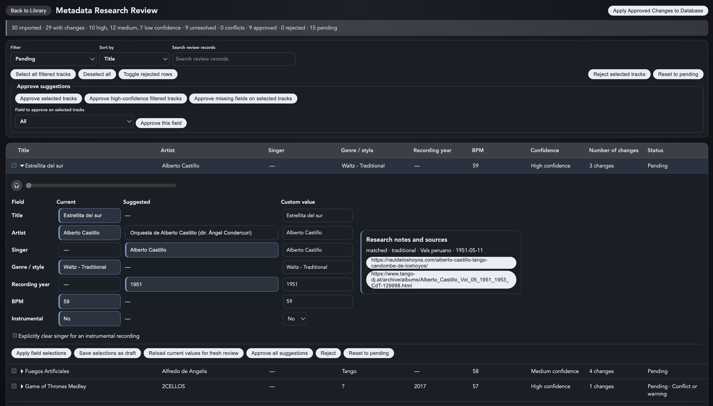

# Metadata Research user guide

Tanda Forge has no built in connection to services that can identify your music.  This page describes a feature to possibly help.  You can use an AI agent such as ChatGPT to do the hard work for you by providing it with a CSV file of some of your tracks' details and then grab the prompt to give the agent by clicking a button to copy it so you can just paste it in to the agent.  Once the agent is done it should return you a CSV file with metadata it found the for the tracks along with a measure of how sure it was of the match.  Tanda Forge provides a screen (see below) through which you can review the new information on offer and incorporate into your library.

Open **Settings → Library** and scroll to **AI Metadata Research**. From this
card you can export tracks, copy the research prompt, import results, and open
the full-page review. This workflow is useful when tracks are missing a genre,
style, or recording year. Research may also suggest corrections to other
fields, such as artist or singer.

## Export, research, and import

1. Choose **Track selection** and a **Batch size**, then click **Export Tracks
   for Research** and choose a destination folder. Export is limited to music
   tracks missing a style or recording year. Turn on **Include previously
   exported tracks** if you want to research eligible tracks again.
2. Choose **Copy AI Research Prompt**. Paste it into your chosen research tool
   and attach an exported CSV. If the export created multiple files, process
   them separately. The prompt asks the tool to preserve the track IDs and
   original columns and append its findings, including sources and uncertainty.
   Check what library metadata the CSV contains before sharing it.
3. Save the returned UTF-8 CSV. In Tanda Forge, choose **Import Research
   Results** and select the file. Check the import summary, then choose **Open
   Review Page**. Importing stages the results for review.

## Review individual tracks

Use **Filter**, **Sort by**, and **Search review records** to find a track.
Expand its row to compare **Current** and **Suggested** values. The highlighted
cell shows the selected value. Click **Current** to keep the library value,
click **Suggested** to use the research value, or type a correction under
**Custom value**.

A dash under **Suggested** means there is no proposed change for that field.
The research may have returned the same value as the library or left it blank.
For example, if no BPM is suggested, keeping **Current** preserves the existing
BPM. A family-level genre match such as **Vals** and **Waltz** can confirm an
existing subtype such as **Waltz – Traditional**. If a research genre has no
matching library style, you can keep the current style and review the other
fields.

Read **Research notes and sources** before accepting changes. Confidence and
match status come from the imported research. Check that the evidence refers
to the specific recording, especially when a title has several recordings or
the local file is an edit. Use the headphone icon to audition the track and
the seek control to move within it. Preview requires a separate headphone
output and is unavailable in Live mode.

If the result flags an unresolved recording match, tick the confirmation only
after checking the evidence. Use **Save selections as draft** to keep your
work pending while you investigate.

## Approve and apply

- **Apply field selections** marks a track with proposed corrections as
  **Approved**. If your choices keep all current values, the track becomes
  **Reviewed — no changes** and needs no database apply. Use **Reset to
  pending** to reopen that review.
- The **Approve suggestions** panel lets you approve eligible selected tracks,
  high-confidence filtered tracks, missing fields on selected tracks, or a
  single field on selected tracks. Bulk approval skips tracks with conflicts or
  warnings that need individual review.
- **Apply Approved Changes to Database** writes the approved corrections.
  Check the confirmation before proceeding. Leave Live mode and stop main
  playback before applying. Successfully written rows show **Applied**.
- To reverse an applied correction, expand the row and choose **Undo track**.
  **Undo batch** offers to restore the applied changes from that import batch.

[Back to the Tanda Forge User Guide](user-guide.md#ai-metadata-research)
